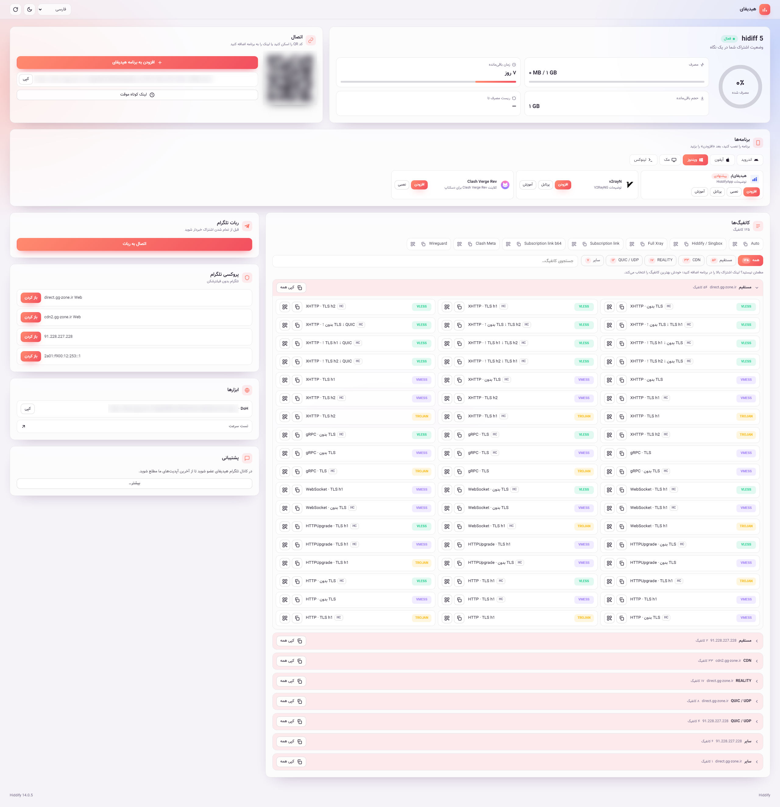
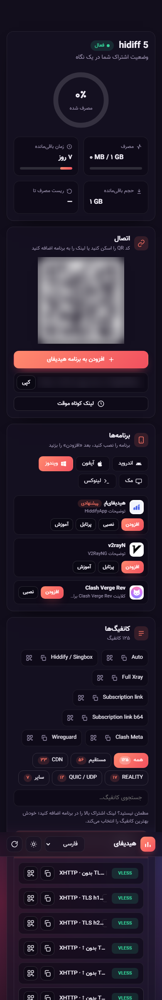

<h1 align="center">Hiddify user page</h1>

<p align="center"><a href="https://hits.sh/github.com/Plus98ir/hiddify-user-page/"></a> <a href="https://corenetbase.com/#support"></a></p>

<details>
<summary><b>☕ Support · حمایت</b> — USDT (TRC20) / TRX</summary>
<br>
<p align="center"></p>

```
TA53aFyGNfSAcrCaJi9QmA9x5W47nPJcf7
```

> [!WARNING]
> **TRON network only.** Sending from ERC20 / BEP20 will lose the funds.<br>
> **فقط شبکه‌ی TRON.** ارسال از ERC20 یا BEP20 پول را از بین می‌برد.

</details>

<div align="center">

[🇬🇧 English](#english) | [🇮🇷 فارسی](#persian)

</div>

---

<a name="english"></a>

## 🇬🇧 English

A one-file user page for [Hiddify Manager](https://github.com/hiddify/hiddify-manager) panels: the subscription at a
glance, the link and QR code, apps per platform, and the configs grouped by kind (direct, CDN, REALITY, QUIC/UDP,
other) and by server, in English and Persian, light and dark.

No build step: `index.html`, three font files and a QR library.

| Desktop (Persian, light) | Phone (Persian, dark) |
| --- | --- |
|  |  |

English, dark: [screenshot](screenshots/userpage_desk_dark_en.png)

## Use it

In the panel: **Settings › Customizing User Page › User page URL**:

    https://github.com/Plus98ir/hiddify-user-page/tree/main

The panel downloads the files itself and serves them on each user's own link, so users never connect to GitHub.
Needs a panel with the custom user page setting (hiddify/HiddifyPanel#79).

To change it, fork this repository, edit `index.html` and put your fork's link in the setting.

## How it works

The panel puts `window.__HIDDIFY__` first in `<head>` (see "Custom user page" in
[hiddify-user-front](https://github.com/hiddify/hiddify-user-front)). The page uses:

- `api_base`: the user API (`me/`, `all-configs/`, `apps/`, `mtproxies/`, `short/`);
- `profile_url` and `deep_link`: the subscription link, its QR code and the Hiddify app button;
- `lang`, `brand_title`, `version`, `page_base`, `proxy_path`, `static_base`.

Opened anywhere else, it only says that it is meant to be shown by a panel.

## Licenses

- Vazir font: SIL Open Font License 1.1, by Saber Rastikerdar.
- `js/qrcode.js`: MIT, by davidshimjs (QRCode.js).

---

<a name="persian"></a>

## 🇮🇷 فارسی

<div align="center">

[🇬🇧 English](#english) | [🇮🇷 فارسی](#persian)

</div>

<div dir="rtl">

یک صفحه‌ی کاربر تک‌فایلی برای پنل‌های [Hiddify Manager](https://github.com/hiddify/hiddify-manager): خلاصه‌ی اشتراک در یک نگاه، لینک و QR کد، برنامه‌ها برای هر سیستم‌عامل، و کانفیگ‌ها دسته‌بندی‌شده بر اساس نوع (مستقیم، CDN، REALITY، QUIC/UDP، بقیه) و بر اساس سرور؛ فارسی و انگلیسی، روشن و تیره.

بدون مرحله‌ی build: یک `index.html`، سه فایل فونت و یک کتابخانه‌ی QR.

| دسکتاپ (فارسی، روشن) | گوشی (فارسی، تیره) |
| --- | --- |
|  |  |

انگلیسی، تیره: [تصویر](screenshots/userpage_desk_dark_en.png)

## استفاده

در پنل: **Settings › Customizing User Page › User page URL**:

</div>

    https://github.com/Plus98ir/hiddify-user-page/tree/main

<div dir="rtl">

پنل خودش فایل‌ها را دانلود می‌کند و روی لینک اختصاصی هر کاربر نشان می‌دهد، پس کاربرها هیچ‌وقت به GitHub وصل نمی‌شوند.
پنلی لازم است که تنظیم صفحه‌ی کاربر سفارشی را داشته باشد (hiddify/HiddifyPanel#79).

برای تغییر دادن، این مخزن را fork کنید، `index.html` را ویرایش کنید و لینک fork خودتان را در همان تنظیم بگذارید.

## چطور کار می‌کند

پنل `window.__HIDDIFY__` را اول `<head>` می‌گذارد (بخش «Custom user page» در [hiddify-user-front](https://github.com/hiddify/hiddify-user-front) را ببینید). صفحه از این‌ها استفاده می‌کند:

- `api_base`: API کاربر (`me/`، `all-configs/`، `apps/`، `mtproxies/`، `short/`)؛
- `profile_url` و `deep_link`: لینک اشتراک، QR کد آن و دکمه‌ی برنامه‌ی Hiddify؛
- `lang`، `brand_title`، `version`، `page_base`، `proxy_path`، `static_base`.

اگر جای دیگری باز شود، فقط می‌گوید که باید از طریق پنل نمایش داده شود.

## مجوزها

- فونت وزیر: SIL Open Font License 1.1، اثر صابر راستی‌کردار.
- `js/qrcode.js`: MIT، اثر davidshimjs (QRCode.js).

</div>
